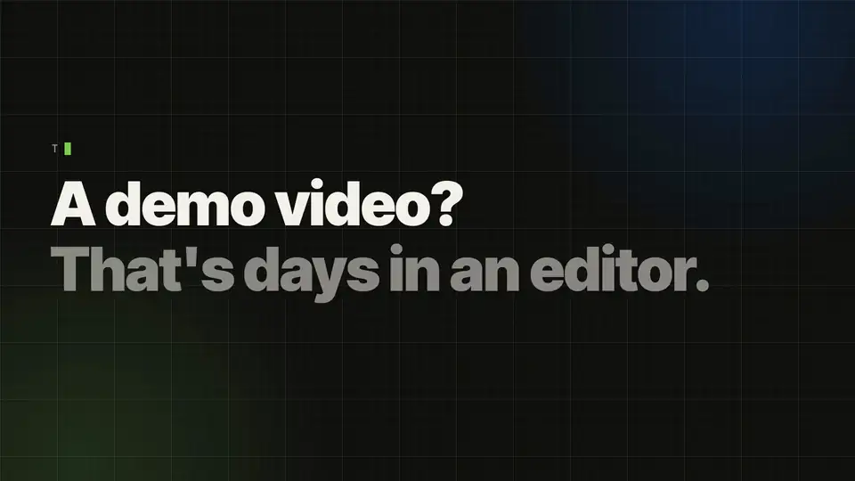

<div align="center">

[English](README.md) · [简体中文](README.zh-CN.md) · **日本語**



# Ultrademo

**プロダクトに目を留めてもらうためのデモ動画。**

実際のプロダクト画面から、AI がプロ品質の動画をわずかな時間で作ります。チャンネルごとのバージョン付きで、そのまま投稿できます。

```bash
npx skills add ultrademo-hq/ultrademo -g -a claude-code
```

あとは Claude Code にこう頼むだけです：`/ultrademo launch video of https://your-product.com`。インストールしただけでは何も表示されません。動画を頼んだときにスキルが動き始めます。

[音声付きで見る](#watch) · [動画の種類](#types) · [仕組み](#how) · [インストール](#install) · [作例](https://ultrademo.net/#showcase)

*上の動画は Ultrademo のローンチ動画です。Ultrademo が自分の画面から作りました。*

</div>

Ultrademo にプロダクト（公開中のサイトやアプリ、まだ公開していない機能の HTML モックアップ、スクリーンショット、Figma ファイル）を渡して、動画を頼んでください。エージェントがストーリーを書き、選べるように方向性をいくつか提案し、すべてのシーンをコードで組み立て、1 コマずつ見て確認し、おかしなところを直します。そのあとナレーションと音楽を付け、レビューページで動画を渡します。コメントは動画の上に直接書けます。プロダクトが変わったら、もう一度実行するだけです。

スキル自体のページ（ブリーフやレビューの画面）は今のところ英語です。エージェントとのやり取りは日本語でかまいません。

<a id="watch"></a>
## 音声付きで見る

https://github.com/user-attachments/assets/b198ca47-1d43-44b1-b622-6d1d4b60afaf

*Ultrademo の解説動画（ナレーション付き）。Ultrademo が自分の画面から作りました。ほかの作例は [ultrademo.net](https://ultrademo.net/#showcase) で。*

## できること

- **5 種類の動画**：**ローンチ（Launch）**、**解説（Explainer）**、**スポットライト（Spotlight、1 つの機能）**、**広告（Ad）**、**チュートリアル（Tutorial）**。どれもプロダクト全体でも、1 つの機能だけでも作れます。
- **ステップごとのチュートリアル**：プロダクトの特定のエリア、最初から最後までのユースケース、または 1 つの機能。クリックのたびにカーソルが映り、ステップごとに番号付きのキャプションが付きます。ステップ間の動きはなしから派手めまで選べ、長い動画はチャプターに分けて作ります。
- **横、縦、または両方。** 縦のバージョンは縦長の画面に合わせてレイアウトし直します。切り抜きではありません。
- SNS 向けの **15 秒・30 秒の短縮版**と、よく使うサイズすべての**サムネイル**。サムネイルの変更も、ほかのコメントと同じように頼めます。
- **字幕**：ナレーション付きの動画にはすべて .srt と .vtt の字幕ファイルが付き、10 種類のスタイル（落ち着いた字幕から 1 語ずつのハイライトまで）で画面に焼き込むこともできます。プロダクトに入力するサンプルの文字は別の色で表示されます。
- **ナレーション付き、または音楽のみ**。大事な瞬間には効果音が入ります。無料の音声があり、自分の ElevenLabs キーがあれば有料の音声も使えます。
- **レビューページ**：動画のある瞬間をクリックし、画面上を枠で囲み、直してほしいことを書きます。エージェントが直して完了にし、何を変えたかを教えてくれます。
- 動画、保存したブランド、ブランドごとにエージェントが学んだことをまとめた**ダッシュボード**。次の動画は最初からイメージに近いところから始まります。

<a id="types"></a>
## 動画の種類

**ローンチ（Launch）** · 通常 20〜60 秒。プロダクトや新機能のお披露目：つかみ、お披露目、動いている成果、締め。ローンチ当日に注目を集めるための動画で、音楽だけのことも多いです。
> `/ultrademo launch video of https://your-product.com`

**解説（Explainer）** · 通常 45 秒〜3 分。プロダクトの使い方：課題、プロダクト、そして主な画面を順番に。1〜3 分のプロダクトツアーも解説動画の一種です。たいていナレーション付き。
> `/ultrademo 90 second explainer of https://your-product.com`

**スポットライト（Spotlight）** · 通常 30〜90 秒。ローンチ動画の勢いはそのままに、紹介ではなくいくつかの価値や機能を軸に組み立てます。機能ページやリリースの投稿に向いています。
> `/ultrademo spotlight on the reporting and the Slack alerts in https://your-product.com`

**広告（Ad）** · 通常 6〜30 秒。有料配信向け：最初の 1 秒でつかみ、根拠を 1 つ、行動の呼びかけを 1 つ。音なしでも伝わり、SNS のフィード向けに縦でも作れます。
> `/ultrademo 15 second ad for https://your-product.com, vertical`

**チュートリアル（Tutorial）** · 通常 1〜5 分、それより長いものはチャプターに分けて。ステップごとに、クリックのたびにカーソルが映り、各ステップに番号付きのキャプションが付きます。3 種類：プロダクトの特定のエリア（ダッシュボードでできること）、最初から最後までのユースケース（メールボックスをつないでから、シーケンスを設定する）、1 つの機能（キャンペーンの仕組み）。冒頭と最後のメッセージは任意です。
> `/ultrademo tutorial: how to set up a support agent in https://app.your-product.com`

どの種類もプロダクト全体でも 1 つの機能でも、横、縦、両方で作れます。どれにするか迷ったら、ブリーフのページで **Unsure** を選んでください。方向性のステップで、ブリーフとサイトから 1 つを選びます。

動画に出てくる画面はすべてあなたのプロダクトのものです。見出しやナレーションの主張はすべて、あなたのサイト、プロダクト、またはあなた自身から来ています。出典が見つからないものは一覧にして、入れる前に確認をお願いします。

<a id="how"></a>
## 仕組み

1. **ブリーフ。** ブラウザでページが開きます。画面をどこから取るか、動画の目的、長さ、声、音楽を指定します。声と音楽はすべてその場で試聴できます。
2. **アウトライン。** 動画の各場面を順番に並べ、それぞれに何が必要かを示します：画面の出どころ、ログインが必要かどうか、プロダクトの中で何かを作成するステップかどうか。Ultrademo はここでログインを試すので、ログインの問題は作業の前にわかります。データを変更するステップは、そのログインがデモ用かテスト用のアカウントだと確認してもらう必要があります。確認がなければ、そのステップは画面から再現して作ります。
3. **方向性。** エージェントがサイトを読み、ラフのコマ付きで最大 3 つの方向性を提案します。1 つ選んで、ページ上で詰めていきます。
4. **シーン。** 各シーンを HTML とアニメーションのコードで書き、レンダリングし、1 コマずつ見て確認します：文字が収まっているか、要素が重なっていないか、シーンのつなぎ目がきれいか。
5. **声と音。** ナレーションを各シーンに合わせ、下に音楽を敷き、動画全体の音量を Web 向けにそろえます。
6. **レビュー。** 見て、コメントして（動画にもサムネイルにも）、承認します。承認した動画には日付入りの最終版が残ります。

<a id="install"></a>
## インストール

必要なもの：Mac か Linux のマシン、[Node.js 22.12+](https://nodejs.org)、ffmpeg（Mac なら `brew install ffmpeg`）、git、約 3 GB の空き容量。それとコーディングエージェントが 1 つ必要です。開発とテストには Claude Code（ターミナル、デスクトップアプリ、VS Code）を使っています。

**Claude Code（ターミナル）：**

```bash
npx skills add ultrademo-hq/ultrademo -g -a claude-code
claude
```

そして `/ultrademo launch video of https://your-product.com` と頼みます。初回はスキルが確認してから `~/ultrademo` に作業環境を用意し（約 10 分）、そのまま動画作りに進みます。

インストールしただけでは何も表示されません。動画を頼んだときにスキルが動き始めます。**Claude にインストールを頼む場合は？** 同じメッセージで動画も頼めば、そのまま続けて作ります：

> Install the Ultrademo skill with `npx skills add ultrademo-hq/ultrademo -g -a claude-code`, then make an explainer video of https://your-product.com

**Claude デスクトップアプリ：** **Code** タブを開き、好きなフォルダを選んで次を送ります：

> Set up Ultrademo from https://github.com/ultrademo-hq/ultrademo: clone it into ~/ultrademo and run npm run setup in its scaffold folder.

終わったら `~/ultrademo/scaffold` をフォルダに選び、動画を頼んでください。

**手動で：**

```bash
git clone https://github.com/ultrademo-hq/ultrademo ~/ultrademo
cd ~/ultrademo/scaffold && npm run setup
```

**Codex、Gemini CLI などのエージェント**も同じ手順書を読みます（`AGENTS.md` から案内されます）。こちらはまだ初期段階で、開発とテストは Claude Code で行っています。

それぞれの詳しい手順と、更新・削除の方法：[INSTALL.md](INSTALL.md)（英語）。

## 費用

Ultrademo は無料のオープンソースです。作業はあなたのエージェントが、あなた自身のプランで行います（Claude Code なら Claude のサブスクリプション）。無料の音声と音楽のみの動画なら、追加の費用はかかりません。有料の音声と生成した効果音は、あなた自身の ElevenLabs アカウントを、そのプランの料金で使います。

## プライバシーと安全

- すべてあなたのマシン上で動きます。ページは `127.0.0.1` で開き、ネットワークからはアクセスできません。
- プロダクトは読み取るだけです。エージェントがプロダクトの中で何かを保存、送信、削除することはありません。ログイン方法を渡さない限り、公開ページだけを使います。
- キーは `scaffold/.env` に、あなた自身が書き込みます。チャットで聞かれることも、表示されることもありません。
- サイト上でエージェントに指示しようとする文章は、コンテンツとして扱われ、あなたに知らされます。
- **利用統計**はデフォルトでオン、匿名です：どのステップまで進んだか、動画の種類と形式、レンダリングにかかった時間、どこで失敗したかを、ランダムなインストール ID と一緒に送ります。プロダクトのアドレスや名前、ブリーフ、台本、画面、ファイルパス、キーは決して送りません。`npm run telemetry -- show` で送った内容をすべて表示でき、`npm run telemetry -- off`（または `DO_NOT_TRACK=1`）でオフにできます。
- 1 日 1 回、新しいバージョンが出ていないか確認してお知らせします。確認なしに更新することはありません。
- レンダラーは 1 つのバージョンに固定し、利用状況の送信と自動更新をオフにして動かしています。パッケージはロックファイルの通りにインストールされます。
- インストールするもの、実行するもの、アクセスする先：[scaffold/REQUIREMENTS.md](scaffold/REQUIREMENTS.md)（英語）。

## 環境のチェック

```bash
cd ~/ultrademo/scaffold && npm run check
```

何もインストールしません。準備ができているもの（パッケージ、ブラウザ、音声、キーのファイル）と、足りないものの直し方を教えてくれます。

## クレジットとライセンス

Ultrademo は [Apache License 2.0](LICENSE) で公開しています。HeyGen の HyperFrames（Apache-2.0）、GSAP、FrameJam と awesome-ai-motion（MIT）、SIL Open Font License のフォント、CC0 の音楽をもとにしています。クレジットとライセンスの全文：[THIRD_PARTY_NOTICES.md](THIRD_PARTY_NOTICES.md) と [NOTICE](NOTICE)。
