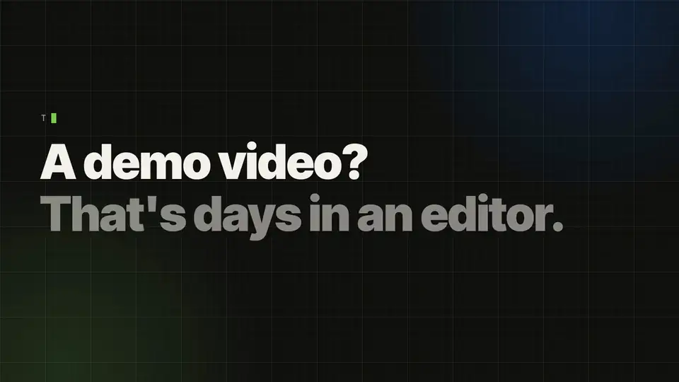

<div align="center">

**English** · [简体中文](README.zh-CN.md) · [日本語](README.ja.md)



# Ultrademo

**Demo videos that get your product noticed.**

Studio-quality video made from your real product by AI, in a fraction of the time. A version for every channel, ready to post.

```bash
npx skills add ultrademo-hq/ultrademo -g -a claude-code
```

Then ask Claude Code: `/ultrademo launch video of https://your-product.com`. Installing alone shows nothing; the skill starts when you ask for a video.

[Watch with sound](#watch-with-sound) · [Video types](#video-types) · [How it works](#how-it-works) · [Install](#install) · [Showcase](https://ultrademo.net/#showcase)

*The video above is Ultrademo's launch video. Ultrademo made it, from its own screens.*

</div>

Point Ultrademo at your product (the live site or app, HTML mockups of a feature that is not live yet, screenshots or a Figma file) and ask for a video. Your agent writes the story, proposes directions for you to pick, builds every scene as code, looks at each frame, checks it, and fixes what is off. Then it adds the voice and music and hands you the video on a review page, where you comment on the video itself. When your product changes, run it again.

## Watch with sound

https://github.com/user-attachments/assets/b198ca47-1d43-44b1-b622-6d1d4b60afaf

*The Ultrademo explainer, narrated, made with Ultrademo from Ultrademo's own screens. More on [ultrademo.net](https://ultrademo.net/#showcase).*

## What you get

- **Five video types**: **Launch**, **Explainer**, **Spotlight** (one feature), **Ad** and **Tutorial**. Each can cover the whole product or one feature.
- **Tutorials** step by step: an area of the product, a use case end to end, or one feature, with the cursor on every click and a numbered caption per step. Motion between steps from none to full, and long videos built in chapters.
- **Landscape, vertical or both.** The vertical version is laid out again for the tall frame, not cropped.
- **Short cuts** of 15 or 30 seconds for social posts, and **thumbnails** in every common size; ask for a change to the thumbnail like any other comment.
- **Captions**: every narrated video comes with an .srt and a .vtt caption file, and you can burn captions into the picture in one of ten styles (from calm subtitles to word-by-word highlights). Example inputs typed into your product show in their own colour.
- **Narration or music only**, with sound effects on the moments that matter. There are free voices, plus paid voices if you bring your own ElevenLabs key.
- **A review page**: click a moment in the video, draw a box on the frame, write what to change. Your agent fixes it, marks it done and tells you what changed.
- **A dashboard** of your videos, your saved brands and what the agent has learned about each brand, so the next video starts closer.

## Video types

**Launch** · typically 20–60 s. A reveal of your product or a new feature: a hook, the reveal, the result in motion and a close. Built to get attention on launch day, often to music alone.
> `/ultrademo launch video of https://your-product.com`

**Explainer** · typically 45 s–3 min. How your product works: the problem, your product, then its main screens in order. A full tour of the product is an explainer at one to three minutes. Usually narrated.
> `/ultrademo 90 second explainer of https://your-product.com`

**Spotlight** · typically 30–90 s. The energy of a launch, built around a few values or features instead of an introduction. Good for a features page or a release post.
> `/ultrademo spotlight on the reporting and the Slack alerts in https://your-product.com`

**Ad** · typically 6–30 s. For paid placement: a hook in the first second, one proof, one call to action. It works with the sound off, and it can come in vertical for social feeds.
> `/ultrademo 15 second ad for https://your-product.com, vertical`

**Tutorial** · typically 1–5 min, longer in chapters. Step by step, with the cursor on every click and a numbered caption per step. Three kinds: an area of your product (what you can do in the dashboard), a use case from start to finish (connect your mailbox, then set up a sequence) or one feature (how campaigns work). An opening message and a closing message are optional.
> `/ultrademo tutorial: how to set up a support agent in https://app.your-product.com`

Any type can cover the whole product or one feature, in landscape, vertical or both. Not sure which type? Choose **Unsure** on the brief page and the direction step picks one from your brief and your site.

Every screen in the video comes from your product. Every claim in the headlines and the narration comes from your site, your product or you. Anything it cannot source is listed for you to confirm before it goes in.

## How it works

1. **Brief.** A page opens in your browser. You say where the screens come from, what the video is for, its length, the voice and the music. You can listen to every voice and music track there.
2. **Outline.** The moments of your video in order, and what each needs: where its screens come from, whether it is behind a sign-in, and whether a step would create something in your product. Ultrademo tests the sign-in here, so a login problem shows before any work. Anything that would change data needs your confirmation that the sign-in is a demo or test account; without it, those steps are rebuilt from your screens.
3. **Direction.** Your agent reads your site and proposes up to three directions, each with sketch frames. You pick one and refine it on the page.
4. **Scenes.** Each scene is written as HTML and animation code, rendered, looked at frame by frame and checked: text fits, nothing overlaps, every join between scenes is clean.
5. **Voice and sound.** The narration is timed to each scene, music is mixed under it, and the whole video is levelled for the web.
6. **Review.** You watch, comment (on the video and the thumbnail) and approve. Approved videos get a dated final copy.

## Install

You need a Mac or Linux machine, [Node.js 22.12+](https://nodejs.org), ffmpeg (`brew install ffmpeg` on a Mac), git and about 3 GB of disk space. You also need a coding agent: Claude Code (terminal, desktop app or VS Code) is the one it is built and tested with.

**Claude Code, in a terminal:**

```bash
npx skills add ultrademo-hq/ultrademo -g -a claude-code
claude
```

Then ask: `/ultrademo launch video of https://your-product.com`. The first time, the skill asks before it sets up its workspace in `~/ultrademo` (about 10 minutes), then carries on with your video.

Installing alone shows nothing: the skill starts when you ask for a video. **Asking Claude to install it for you?** Put the video in the same message and it carries straight on:

> Install the Ultrademo skill with `npx skills add ultrademo-hq/ultrademo -g -a claude-code`, then make an explainer video of https://your-product.com

**Claude desktop app:** open the **Code** tab, choose any folder and send:

> Set up Ultrademo from https://github.com/ultrademo-hq/ultrademo: clone it into ~/ultrademo and run npm run setup in its scaffold folder.

When it is done, choose `~/ultrademo/scaffold` as the folder and ask for your video.

**By hand:**

```bash
git clone https://github.com/ultrademo-hq/ultrademo ~/ultrademo
cd ~/ultrademo/scaffold && npm run setup
```

**Codex, Gemini CLI and other agents** read the same instructions (`AGENTS.md` points them there). This is early: it is built and tested with Claude Code.

Step-by-step versions of each, plus updating and removing: [INSTALL.md](INSTALL.md).

## What it costs

Ultrademo is free and open source. The work is done by your agent, on your own plan (for Claude Code, your Claude subscription). The free voices and music-only videos cost nothing more. Paid voices and generated sound effects use your own ElevenLabs account, at your plan's rates.

## Privacy and safety

- Everything runs on your machine. The pages open at `127.0.0.1` and are never reachable from the network.
- Your product is only read. The agent never saves, sends or deletes anything in it, and uses public pages unless you give it a way to sign in.
- Keys live in `scaffold/.env`, typed there by you. They are never asked for in the chat and never printed.
- Text on your site that tries to give the agent instructions is treated as content and flagged to you.
- **Usage statistics** are on by default and anonymous: which steps are reached, video types and formats, how long renders take, where it fails, sent with a random install id. Never your product's address or name, your brief, scripts, frames, file paths or keys. `npm run telemetry -- show` lists everything sent, and `npm run telemetry -- off` (or `DO_NOT_TRACK=1`) switches it off.
- Once a day it checks whether a newer version is out, and tells you. It never updates without asking.
- The renderer is pinned to one version and runs with usage reporting and self-updates switched off. Packages install exactly as the lockfile lists them.
- What it installs, runs and reaches: [scaffold/REQUIREMENTS.md](scaffold/REQUIREMENTS.md).

## Check your setup

```bash
cd ~/ultrademo/scaffold && npm run check
```

It installs nothing. It says what is ready (packages, browsers, voices, your key file) and how to fix anything that is missing.

## Credits and licence

Ultrademo is released under the [Apache License 2.0](LICENSE). It builds on HyperFrames by HeyGen (Apache-2.0), GSAP, FrameJam and awesome-ai-motion (MIT), fonts under the SIL Open Font License, and CC0 music. Full credits and licence texts: [THIRD_PARTY_NOTICES.md](THIRD_PARTY_NOTICES.md) and [NOTICE](NOTICE).
