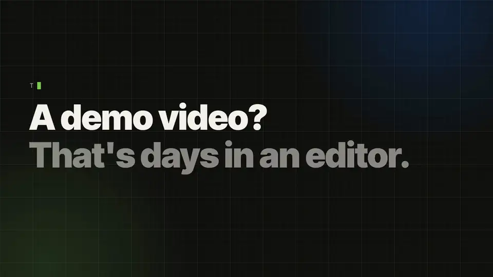

<div align="center">

[English](README.md) · **简体中文** · [日本語](README.ja.md)



# Ultrademo

**让你的产品被看见的演示视频。**

用你真实的产品画面，由 AI 做出专业水准的视频，只花一小部分时间。每个渠道一个版本，拿来就能发。

```bash
npx skills add ultrademo-hq/ultrademo -g -a claude-code
```

然后对 Claude Code 说：`/ultrademo launch video of https://your-product.com`。只安装不会显示任何东西，你请求做视频时技能才会开始。

[带声音观看](#watch) · [视频类型](#types) · [工作方式](#how) · [安装](#install) · [作品展示](https://ultrademo.net/#showcase)

*上面这段是 Ultrademo 的发布视频，由 Ultrademo 用自己的界面做出来。*

</div>

把 Ultrademo 指向你的产品（线上网站或应用、还没上线的功能的 HTML 原型、截图或 Figma 文件），然后要一支视频。你的 agent 会写故事，给出几个方向让你挑，把每个场景写成代码，逐帧查看、检查并修正问题。之后配上旁白和音乐，在审阅页里把视频交给你，你可以直接在视频上评论。产品改版了，再跑一次就行。

技能自带的页面（需求页、审阅页等）目前是英文的；你可以用中文和 agent 对话。

<a id="watch"></a>
## 带声音观看

https://github.com/user-attachments/assets/b198ca47-1d43-44b1-b622-6d1d4b60afaf

*Ultrademo 的讲解视频，带旁白，由 Ultrademo 用自己的界面做出来。更多作品见 [ultrademo.net](https://ultrademo.net/#showcase)。*

## 你会得到什么

- **五种视频类型**：**发布视频（Launch）**、**讲解视频（Explainer）**、**功能聚焦（Spotlight，讲一个功能）**、**广告（Ad）** 和 **教程（Tutorial）**。每种都可以讲整个产品，也可以只讲一个功能。
- **分步教程**：产品的某个区域、一个从头到尾的使用场景，或一个功能。每次点击都有鼠标指针，每一步都有编号字幕。步骤之间的动效可以从无到丰富，长视频按章节制作。
- **横屏、竖屏或两者都要。** 竖屏版本会为竖直画面重新排版，而不是裁切。
- **15 秒或 30 秒的短版**，适合社交媒体；还有各种常用尺寸的**封面图**。想改封面，像其他评论一样提出来就行。
- **字幕**：每支有旁白的视频都附带 .srt 和 .vtt 字幕文件，也可以把字幕直接烧进画面，有十种样式（从安静的字幕到逐词高亮）。在产品里输入的示例内容会用单独的颜色显示。
- **旁白或纯音乐**，在关键时刻配上音效。有免费的声音；如果你有自己的 ElevenLabs 密钥，也可以用付费声音。
- **审阅页**：点视频里的某个时刻，在画面上框出一块，写下要改什么。你的 agent 会修好它，标记完成，并告诉你改了什么。
- **一个面板**，列出你的视频、保存的品牌，以及 agent 对每个品牌学到的东西，下一支视频会更接近你要的样子。

<a id="types"></a>
## 视频类型

**发布视频（Launch）** · 通常 20–60 秒。揭晓你的产品或新功能：开场钩子、揭晓、实际效果、收尾。为发布日吸引注意力而做，常常只配音乐。
> `/ultrademo launch video of https://your-product.com`

**讲解视频（Explainer）** · 通常 45 秒到 3 分钟。讲清楚你的产品怎么用：问题、你的产品，然后按顺序展示主要界面。一到三分钟的完整产品导览也属于讲解视频。通常有旁白。
> `/ultrademo 90 second explainer of https://your-product.com`

**功能聚焦（Spotlight）** · 通常 30–90 秒。有发布视频的节奏，但围绕几个价值点或功能展开，而不是从头介绍。适合功能页或版本发布帖。
> `/ultrademo spotlight on the reporting and the Slack alerts in https://your-product.com`

**广告（Ad）** · 通常 6–30 秒。用于付费投放：第一秒就有钩子，一个证据，一个行动号召。静音也能看懂，也可以做成竖屏用于社交信息流。
> `/ultrademo 15 second ad for https://your-product.com, vertical`

**教程（Tutorial）** · 通常 1–5 分钟，更长的按章节制作。一步一步来，每次点击都有鼠标指针，每一步都有编号字幕。三种：产品的某个区域（仪表盘里能做什么）、一个从头到尾的使用场景（先连接邮箱，再设置一个序列），或一个功能（活动是怎么运作的）。开头和结尾的说明可选。
> `/ultrademo tutorial: how to set up a support agent in https://app.your-product.com`

任何类型都可以讲整个产品或一个功能，横屏、竖屏或两者都要。不确定选哪种？在需求页选 **Unsure**，方向这一步会根据你的需求和网站替你选一种。

视频里的每个画面都来自你的产品。标题和旁白里的每个说法都来自你的网站、你的产品或你本人。找不到出处的说法会列出来，等你确认后才会放进去。

<a id="how"></a>
## 工作方式

1. **需求。** 浏览器里会打开一个页面。你说明画面从哪里来、视频做什么用、多长、用什么声音和音乐。每个声音和每首音乐都可以在那里试听。
2. **大纲。** 按顺序列出视频的各个时刻，以及每个时刻需要什么：画面从哪里来、是否需要登录、某一步是否会在你的产品里创建东西。Ultrademo 会在这里测试登录，登录有问题会在开工之前就暴露出来。任何会改动数据的步骤，都需要你确认登录用的是演示或测试账号；否则这些步骤会根据你的界面重新搭建。
3. **方向。** 你的 agent 读你的网站，给出最多三个方向，每个都有草图帧。你挑一个，在页面上继续细化。
4. **场景。** 每个场景都写成 HTML 和动画代码，渲染出来，逐帧查看和检查：文字放得下，元素不重叠，场景之间的每个衔接都干净。
5. **声音。** 旁白按场景对好时间，音乐垫在下面，整支视频按网络播放的标准统一音量。
6. **审阅。** 你观看、评论（视频和封面都可以评论）并批准。批准的视频会得到一份带日期的最终版本。

<a id="install"></a>
## 安装

你需要一台 Mac 或 Linux 电脑、[Node.js 22.12+](https://nodejs.org)、ffmpeg（Mac 上用 `brew install ffmpeg`）、git，以及大约 3 GB 磁盘空间。还需要一个编程 agent：Claude Code（终端、桌面应用或 VS Code）是它开发和测试时用的那一个。

**Claude Code，在终端里：**

```bash
npx skills add ultrademo-hq/ultrademo -g -a claude-code
claude
```

然后输入：`/ultrademo launch video of https://your-product.com`。第一次使用时，技能会先问你，再在 `~/ultrademo` 里搭好工作区（大约 10 分钟），然后继续做你的视频。

只安装不会显示任何东西：你请求做视频时，技能才会开始。**想让 Claude 帮你安装？** 在同一条消息里写上要做的视频，它装好后会直接接着做：

> Install the Ultrademo skill with `npx skills add ultrademo-hq/ultrademo -g -a claude-code`, then make an explainer video of https://your-product.com

**Claude 桌面应用：** 打开 **Code** 标签页，选任意一个文件夹，发送：

> Set up Ultrademo from https://github.com/ultrademo-hq/ultrademo: clone it into ~/ultrademo and run npm run setup in its scaffold folder.

完成后，把 `~/ultrademo/scaffold` 选为文件夹，然后要你的视频。

**手动安装：**

```bash
git clone https://github.com/ultrademo-hq/ultrademo ~/ultrademo
cd ~/ultrademo/scaffold && npm run setup
```

**Codex、Gemini CLI 和其他 agent** 读的是同一份说明（`AGENTS.md` 会指过去）。这部分还在早期：它是用 Claude Code 开发和测试的。

每种方式的分步说明，以及更新和卸载：[INSTALL.md](INSTALL.md)（英文）。

## 费用

Ultrademo 免费且开源。活由你的 agent 在你自己的套餐上完成（对 Claude Code 来说，就是你的 Claude 订阅）。免费声音和纯音乐视频不会再产生额外费用。付费声音和生成的音效使用你自己的 ElevenLabs 账号，按你套餐的价格计费。

## 隐私与安全

- 一切都在你的电脑上运行。页面在 `127.0.0.1` 打开，网络上的其他设备访问不到。
- 你的产品只会被读取。agent 不会在里面保存、发送或删除任何东西；除非你给它登录的方式，否则只用公开页面。
- 密钥放在 `scaffold/.env` 里，由你自己填写。聊天里从不索要，也从不打印出来。
- 你网站上试图给 agent 下指令的文字，会被当作内容处理，并标出来告诉你。
- **使用统计**默认开启且匿名：到达了哪些步骤、视频类型和格式、渲染用了多久、在哪里出错，附带一个随机的安装 ID。绝不包括你产品的地址或名字、你的需求、脚本、画面、文件路径或密钥。`npm run telemetry -- show` 列出所有发送的内容，`npm run telemetry -- off`（或 `DO_NOT_TRACK=1`）可以关闭。
- 每天检查一次是否有新版本，并告诉你。不经你同意从不自动更新。
- 渲染器固定在一个版本，关闭了使用上报和自动更新。依赖包严格按锁文件安装。
- 它安装、运行和访问的内容：[scaffold/REQUIREMENTS.md](scaffold/REQUIREMENTS.md)（英文）。

## 检查你的环境

```bash
cd ~/ultrademo/scaffold && npm run check
```

它不会安装任何东西。它会告诉你哪些已经就绪（依赖包、浏览器、声音、密钥文件），以及缺的东西怎么补上。

## 致谢与许可

Ultrademo 以 [Apache License 2.0](LICENSE) 发布。它建立在 HeyGen 的 HyperFrames（Apache-2.0）、GSAP、FrameJam 和 awesome-ai-motion（MIT）、SIL Open Font License 下的字体以及 CC0 音乐之上。完整的致谢和许可文本：[THIRD_PARTY_NOTICES.md](THIRD_PARTY_NOTICES.md) 和 [NOTICE](NOTICE)。
